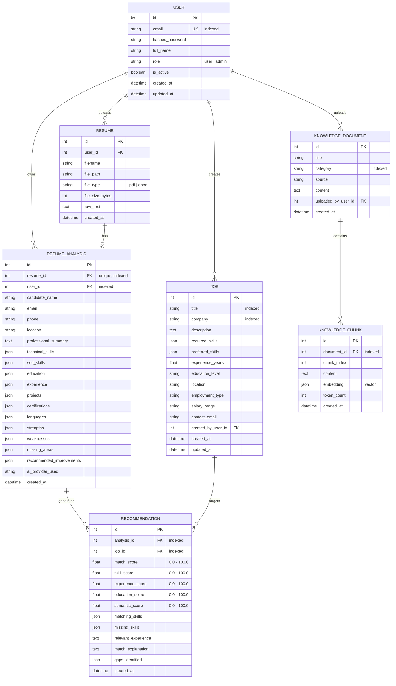

# Database Design & Entity-Relationship (ER) Documentation

The application uses an SQLite relational database managed via SQLAlchemy ORM. The schema is normalized, indexed for high-speed queries, and supports cascade deletions for child records.

---

## 1. Entity-Relationship (ER) Diagram

---

## 2. Table Specifications

### 2.1 `users`
- Stores registered candidate and administrator accounts.
- `email`: Indexed and unique.
- `hashed_password`: Stored using standard `bcrypt` hashing with salt rounds.

### 2.2 `resumes`
- Tracks uploaded PDF and DOCX files.
- `raw_text`: Cleaned text extracted by the `ResumeParser`.
- Deleting a resume cascades to delete its associated analysis and recommendations.

### 2.3 `resume_analyses`
- Stores structured candidate profiles generated by the Resume Analyzer Agent (Agent 1).
- JSON columns (`technical_skills`, `education`, `experience`, `strengths`, `weaknesses`) store rich structured data natively.

### 2.4 `jobs`
- Job board directory.
- Supports multi-criteria filtering by title, company, required skill, experience duration, and location.
- `contact_email`: Optional email address for job applications. Validated as a proper email format on input.

### 2.5 `recommendations`
- Stores computed matches calculated by the Job Matching Agent (Agent 2).
- Records the complete 4-part score breakdown: `skill_score`, `experience_score`, `education_score`, `semantic_score`, alongside `match_score` and AI-generated `match_explanation`.

### 2.6 `knowledge_documents` & `knowledge_chunks`
- Powers the RAG Knowledge Base.
- Documents are split into overlapping chunks, each stored with a 64-dimensional dense embedding vector in `knowledge_chunks.embedding` for fast cosine similarity calculation.
